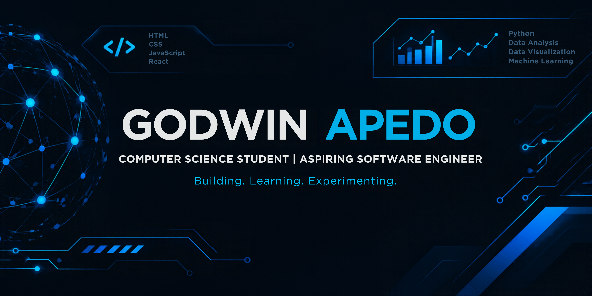

<!-- ============================================ -->

<!-- GODWIN APEDO | GITHUB PROFILE README         -->

<!-- ============================================ -->

 

 

---

## 👨🏽‍💻 About Me

Hey! I'm **Godwin Apedo**, a Computer Science student at the **University of Ghana**, passionate about technology, software development, and building things that solve real problems.

I enjoy exploring ideas, experimenting with technologies, and turning concepts into functional applications. My interests span software engineering, frontend development, data analytics, and product development.

A few things about me:

* 🎓 Pursuing a BSc in Computer Science at the University of Ghana.
* 💻 Interested in software engineering and frontend development.
* 📊 Exploring data analytics and data-driven solutions.
* 🚀 Building personal projects and collaborating on software projects.
* 💡 Interested in the intersection of technology, entrepreneurship, and problem-solving.
* 🌱 Always learning, experimenting, and improving.

## 🧭 What I'm Exploring

* Building modern and responsive web applications.
* Improving my software engineering and programming skills.
* Exploring data analytics and working with data.
* Understanding how technology can be used to build meaningful products.

## 🛠️ Technologies & Tools

### Languages

  

### Frameworks & Libraries

  

### Databases & Platforms

  

### Development & Design Tools

  

## 🚀 Featured Projects

### 01. Godwin Apedo | Personal Portfolio

My personal portfolio website, built to showcase my background, technical skills, selected projects, and journey in technology.

**Technologies:** Next.js · TypeScript · Tailwind CSS · Motion

### 02. Chef Apedo Foods

A personal food business project combining entrepreneurship and technology, with a focus on bringing Ghanaian meals closer to customers through a digital ordering experience.

**Technologies:** Next.js · Tailwind CSS · Supabase

---

## 📊 GitHub Statistics

 

---

## 🤝 Let's Connect

I'm always happy to connect with fellow developers, exchange ideas, collaborate on interesting projects, and explore opportunities to learn and grow.

---

### Still learning. Still building. Always evolving.

*Thanks for stopping by!*

